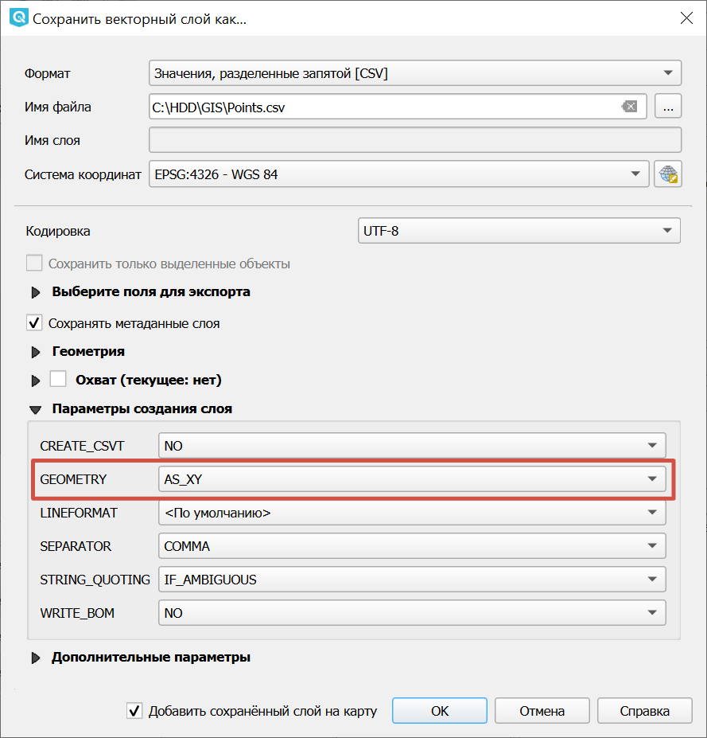

Извлечение высот
================

Инструмент извлекает значение высот в заданных точках из цифровой модели рельефа (DEM). Возвращает CSV-файл с координатами и высотами для заданных точек.

На входе:

* Исходный файл - Файл CSV или XLS(X) с координатами точек в EPSG:4326. Названия колонок должны быть на латинице. `Как подготовить файл CSV в QGIS <https://docs.nextgis.ru/docs_toolbox/source/deminpoints.html#prepare>`_.
* Имя колонки с широтой - Название колонки с широтой в исходном файле;
* Имя колонки с долготой - Название колонки с долготой в исходном файле;
* Выходной формат - выберите из списка:

  - CSV
  - ESRI Shapefile
  - MapInfo TAB
  - GeoJSON (GeoJSON)
  - GeoPackage (GPKG)
  - DXF
  - FlatGeobuf

* Название цифровой модели рельефа - выберите из списка:

  - Copernicus (copernicus)
  - ALOS (alos) -  ALOS World 3D, разрешение 30 метров.
  - MERITDEM (meritdem)
  - GEBCO (gebco) разрешение - 15 угловых секунд (приблизительно 500 метров).

На выходе:

*  Файл выбранного формата с координатами и высотами для заданных точек.

.. _prepare:

Как подготовить данные в формате CSV
~~~~~~~~~~~~~~~~~~~~~~~~~~~~~~~~~~~~

Чтобы файл CSV был корректно обработан инструментом, он должен отвечать следующим требованиям:

* Разделитель для CSV-файла - запятая. 
* Координаты представлены в градусах, разделитель целой и дробной части - точка.
* Названия колонок не должны содержать пробелов. 
* Всё содержимое CSV файла (включая данные) должно быть на латинице.

Чтобы экспортировать из NextGIS QGIS точечный слой в файл CSV с координатами, выберите в меню :menuselection:`Слой --> Сохранить как`. В окне сохранения выберите формат *CSV - текст с разделителями*. 

В разделе **Паметры создания слоя** для поля GEOMETRY выберите ``AS_XY``. При этом в колонку X запишутся значения долготы, в колонку Y - широты.

   Экспорт точечного слоя в CSV

.. raw:: html

   <iframe width="720" height="405" src="https://rutube.ru/play/embed/6110c141543a4b13609b5d645736fca9/" frameBorder="0" allow="clipboard-write; autoplay" webkitAllowFullScreen mozallowfullscreen allowFullScreen></iframe>

Посмотреть видео на `youtube <https://youtu.be/yy3SlXBG6Xk>`_, `rutube <https://rutube.ru/video/6110c141543a4b13609b5d645736fca9/>`_.

Запуск инструмента: https://toolbox.nextgis.com/t/demInPoints

**Попробуйте инструмент в действии**

1. Нажмите кнопку **Демо** над формой инструмента. Поля будут автоматически заполнены демонстрационными значениями.
2. Нажмите кнопку **Запустить**.

