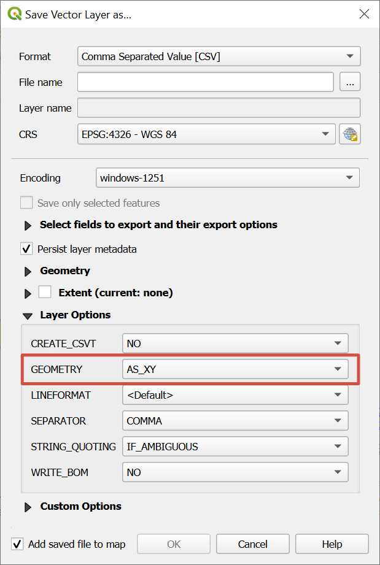

Extract elevations from DEM
===========================

The extraction of elevations from DEM. Returns CSV with coordinates and altitude.

Inputs:

* Input file - CSV or XLS(X) file with points coordinates in EPSG:4326. Column names must be in Latin. `How to prepare CSV file in QGIS <https://toolbox.nextgis.com/t/deminpoints#prepare>`_.
* Name of the latitude column - Name of latitude column in the input file;
* Name of the longitude column - Name of longitude column in the input file;
* Output format - select from the list:

  - CSV
  - ESRI Shapefile
  - MapInfo TAB
  - GeoJSON
  - GeoPackage (GPKG)
  - DXF
  - FlatGeobuf

* Elevation dataset - choose from the list:

  - Copernicus
  - ALOS -  ALOS World 3D has resolution of 30 meters
  - MERITDEM
  - GEBCO - resolution is 15 sec (about 500 meters). 

Outputs:

*  File in the selected format with coordinates and elevation values for the points.

.. _prepare:

How to prepare CSV file
~~~~~~~~~~~~~~~~~~~~~~~

CSV file must have the following parameters:

* Delimiter should be comma. 
* Corrdinates are float values. 
* File should not have spaces and should contain only latin symbols. 

To save a point layer as a CSV file with coordinates in QGIS, go to :menuselection:`Layer --> Save as`. In the Format field select *Comma separated values*.

In the **Layer options** section select for the GEOMETRY field the option ``AS_XY``. The resulting file will have longitude in the X column and latitude in Y column. 

   Exporting point layer as CSV

Launch the tool: https://toolbox.nextgis.com/t/demInPoints

**Try the tool in action**

1. Click on the **Demo** button above the tool form. The fields are filled in with demo values.
2. Click on the **Run** button.

.. admonition:: Related tools

  * `Improve DEM <https://toolbox.nextgis.com/t/improvedem?from-related-tools=1>`_
