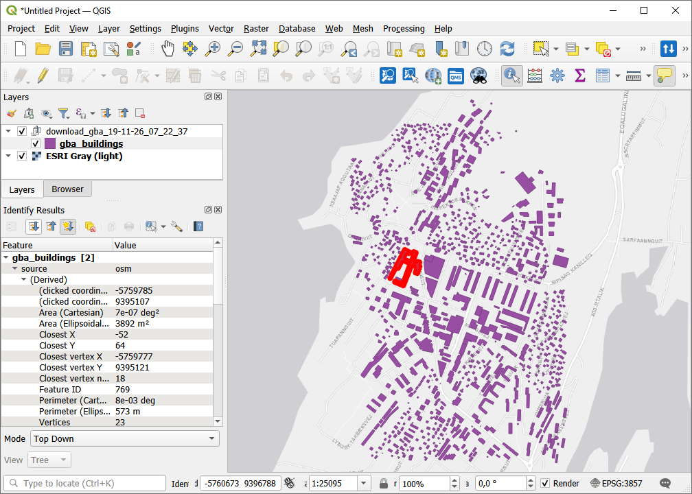

Download Global Buildings Atlas data
====================================

Download building polygons from GlobalBuildingAtlas (GBA) for the selected area.

Inputs:

* Bounding box - draw your area of interest on the map or enter coordinates in decimal degrees (West, South, East, North in WGS84). Area size limit is 50 km\ :sup:`2`.
* Output format - select from the list:

  - GeoPackage (GPKG)
  - GeoJSON (GeoJSON)

Outputs:

* File with building polygons.
* Text report on the number of features.

Launch the tool: https://toolbox.nextgis.com/t/download_gba

Example:

   Example output

**Try the tool in action**

1. Click on the **Demo** button above the tool form. The fields are filled in with demo values.
2. Click on the **Run** button.

.. admonition:: Related tools

   * `Clip PBF file by bbox <https://toolbox.nextgis.com/t/osmclip_bbox?from-related-tools=1>`_
   * `Search & download Planetary Computer <https://toolbox.nextgis.com/t/planetary_search?from-related-tools=1>`_