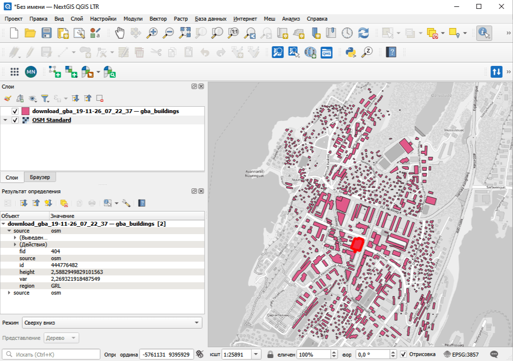

Скачивание данных Global Buildings Atlas
========================================

Позволяет скачать геоданные объектов строений из глобального датасета GlobalBuildingAtlas (GBA) в границах заданного охвата.

На входе:

* Ограничивающий прямоугольник - нарисуйте на карте или введите вручную координаты рамки области интереса (запад, юг, восток, север в WGS84). Площадь области интереса не должна быть более 50 км\ :sup:`2`.
* Выходной формат - выберите из списка:

  - GeoPackage (GPKG)
  - GeoJSON (GeoJSON)

На выходе:

* Файл с полигонами зданий;
* Текстовый отчёт о количестве загруженных зданий.

Запуск инструмента: https://toolbox.nextgis.com/t/download_gba

Пример работы инструмента:

   Полученные данные по зданиям, открытые в NextGIS QGIS

**Попробуйте инструмент в действии:**

1. Нажмите кнопку **Демо** над формой инструмента. Поля будут автоматически заполнены демонстрационными значениями.
2. Нажмите кнопку **Запустить**.

.. seealso::

   * `Обрезать PBF по прямоугольнику <https://toolbox.nextgis.com/t/osmclip_bbox?from-related-tools=1>`_
   * `Скачивание данных Planetary Computer <https://toolbox.nextgis.com/t/planetary_search?from-related-tools=1>`_