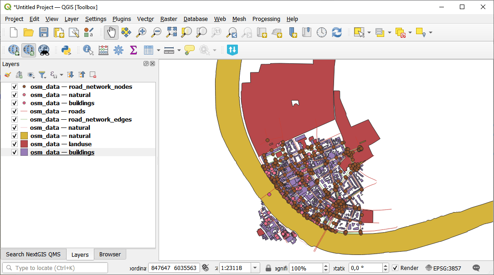

Download OpenStreetMap
======================

Download OpenStreetMap features (buildings, roads, landuse, etc.) for a given bounding box via the Overpass API. Returns a ZIP archive with a GeoPackage containing one layer per category and a manifest.

Inputs:

* Bounding box - Area of interest (west, south, east, north in WGS84). Maximum area: 100 km²;
* Categories - Comma-separated OSM categories to download. Available: ``buildings, roads, paths, landuse, natural, waterways, amenities, shops, tourism`` (default: buildings,roads,landuse);
* Custom tags (JSON) - JSON object with custom OSM tags, e.g. {"leisure": "park", "railway": true}. Values: string, true or list of strings;
* Network type - road network type to download (only used when 'roads' category is selected, ``drive`` by default):

  - Drive
  - Walk
  - Bike
  - All

Outputs:

* ZIP archive with a GeoPackage containing one layer per category;
* Text report with the number of features for each layer;
* JSON manifest.

Launch the tool: https://toolbox.nextgis.com/t/osm_download

Example:

   Downloaded data

**Try the tool in action**

1. Click on the **Demo** button above the tool form. The fields are filled in with demo values.
2. Click on the **Run** button.

.. admonition:: Related tools

  * `Prepare and download Sentinel-2 data <https://toolbox.nextgis.com/t/download_and_prepare_l8_s2?from-related-tools=1>`_
  * `Search & download Planetary Computer <https://toolbox.nextgis.com/t/planetary_search?from-related-tools=1>`_
  * `Clip PBF file by bbox <https://toolbox.nextgis.com/t/osmclip_bbox?from-related-tools=1>`_