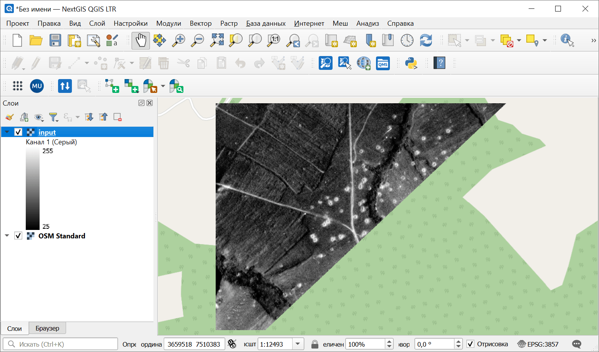
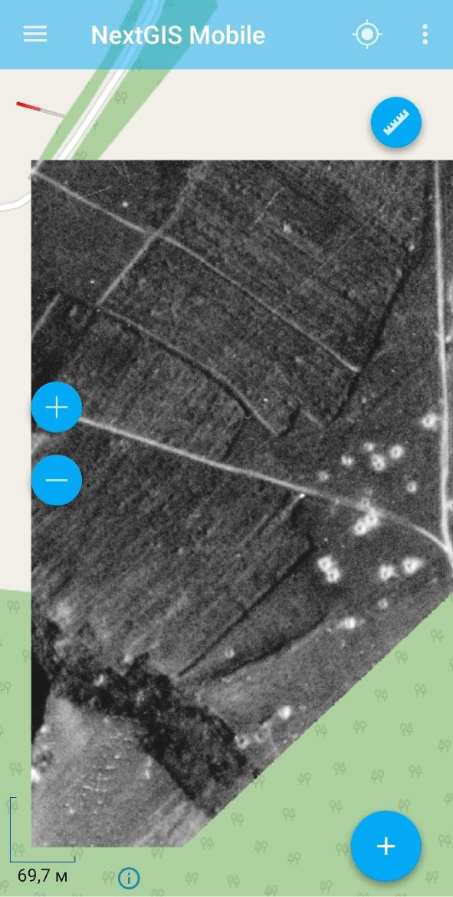

Растр в MBTiles
===============

Генерация набора тайлов в формате MBTiles из исходного набора растровых данных (поддерживаемого GDAL).

На входе:

* Исходный растр - GDAL-совместимый растр: RGB, RGBA, одноканальный серый или одноканальный с палитрой;
* Масштабные уровни - Необязательно. Диапазон, например, ``8-14``;
* Имя выходного файла - Необязательно. Имя для выходного файла MBTiles. Расширение *.mbtiles* будет добавлено автоматически.

На выходе:

* Тайлы в формате MBTiles.

Запуск инструмента: https://toolbox.nextgis.com/t/raster2mbtiles

Пример работы инструмента:

   Исходный растр в NextGIS QGIS

   Тайлы MBTiles в NextGIS Mobile

**Попробуйте инструмент в действии:**

1. Нажмите кнопку **Демо** над формой инструмента. Поля будут автоматически заполнены демонстрационными значениями.
2. Нажмите кнопку **Запустить**.

