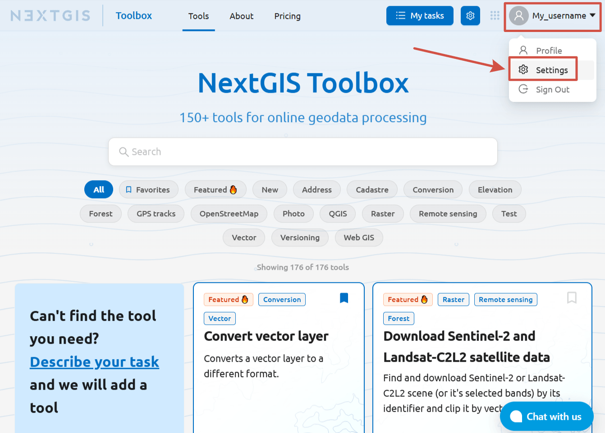
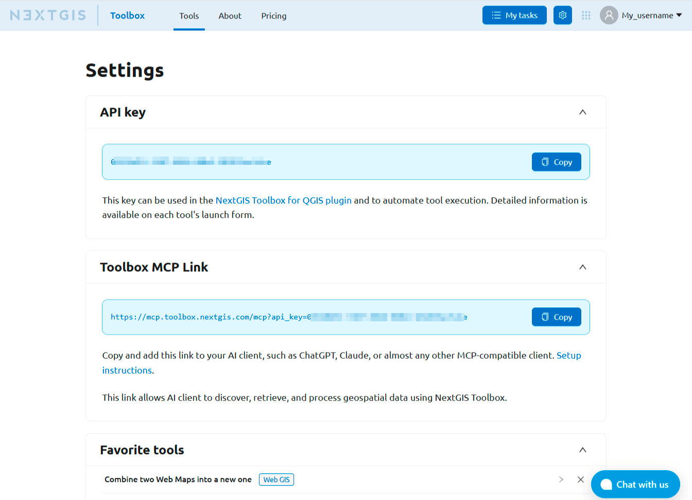

User settings
=======================

Click on the username in the upper right corner and select **Settings** from the menu.

   Opening settings

On this page, you can copy:

* API key for authorization in the `Toolbox plugin for QGIS <https://docs.nextgis.com/docs_ngqgis/source/toolbox.html>`_ 
* a link to configure the `MCP server in your AI client <https://docs.nextgis.com/docs_toolbox/source/mcp.html>`_ to run Toolbox tools via chat.

   Toolbox user settings page

Also, here you can find the list of tools added to favorites.
