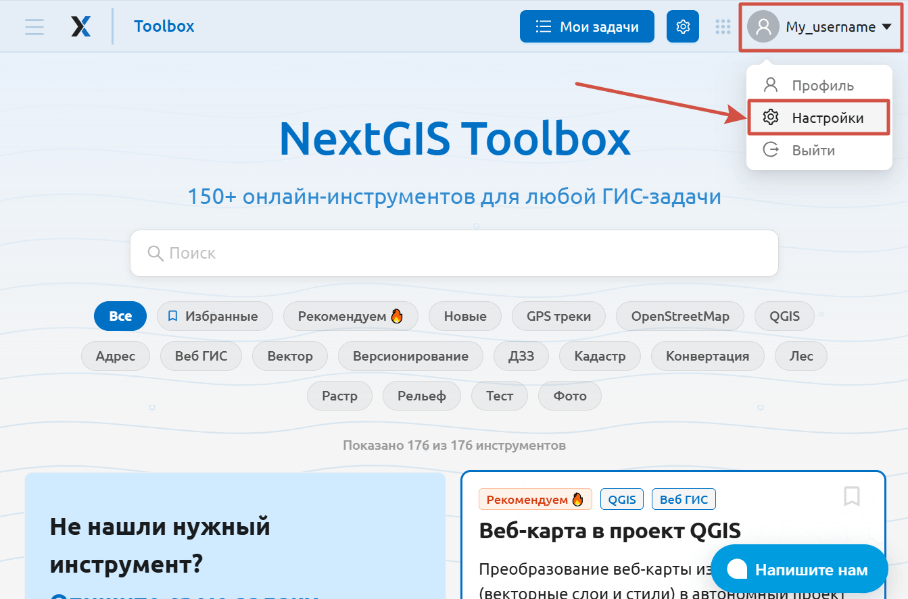
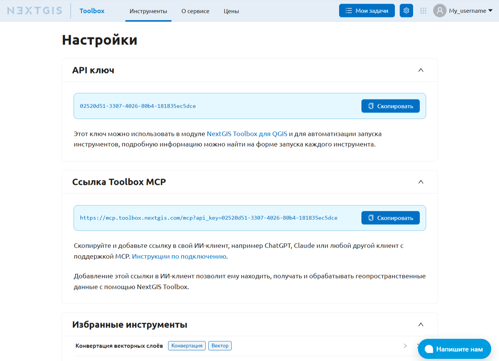

Настройки пользователя
=======================

Нажмите на имя пользователя в правом верхнем углу и в открывшемся меню выберите **Настройки**.

   Открытие настроект

На этой странице вы можете скопировать:

* API-ключ для авторизации в `модуле расширения Toolbox для QGIS <https://docs.nextgis.ru/docs_ngqgis/source/toolbox.html>`_ 
* ссылку для настройки `MCP-сервера в вашем ИИ-клиенте <https://docs.nextgis.ru/docs_toolbox/source/mcp.html>`_, чтобы запускать инструменты Toolbox через чат.

   Страница пользовательских настроек Toolbox

Также здесь представлен список инструментов, добавленных в избранное.
